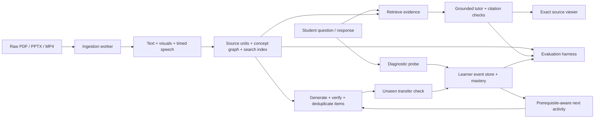

# Proposed architecture

This is an implementation design. Only the small Python learner/selection module currently exists.



## Stack decisions

Use familiar React/TypeScript for the UI. A Python API and background worker keep PDF rendering, media processing and Ragas in one ecosystem. PostgreSQL holds sources, evidence units, attempts, topic state and vectors; object storage holds authorized uploads and rendered assets. The first development deployment can run API/worker locally. Do not force lengthy media ingestion into a short-lived serverless request.

A configurable multimodal provider can analyze page images and videos. [Gemini's document guide](https://ai.google.dev/gemini-api/docs/document-processing) and [video guide](https://ai.google.dev/gemini-api/docs/video-understanding) establish supported input capabilities; they do not guarantee correct visual interpretation or exact timestamps. Validate both against the course packet. Select and pin the actual model available to the team rather than assume an old model name remains available. Keep credentials server-side and check current quotas with the chosen account.

## Ingestion and provenance

1. Accept bounded raw uploads and store a content hash. Assign course/source IDs. Show queued, extracting, indexed and failed states.
2. PDF: extract text per page and render page images. Identify figure regions and attach nearby captions/text. A vision pass describes labels, arrows and relationships, while retaining the original pixels.
3. PPTX: extract slide text and relationships; render original slides in a worker. Use slide images for layout/diagram interpretation. Retain slide numbers and render assets, not just a text dump.
4. MP4: obtain speech with timed segments and inspect sampled frames; retain frame time and original media. A diagram shown only in the lecture must survive extraction. Segment/frame times are verified against playback. No manually supplied transcript is required.
5. Tag units by topic/concept and propose prerequisite edges. Mark inferred edges as tentative; review the compact demo graph. Never confuse an extracted statement with a validated teaching fact.
6. Index text and visual descriptions using hybrid lexical/vector retrieval. Retrieve the original image alongside its description for figure questions.

An evidence unit includes `unit_id`, `course_id`, `source_id`, `source_hash`, `modality`, `page_or_slide`, `start_seconds`, `end_seconds`, optional normalized `bounding_box`, `text`, `visual_asset_id`, `concept_ids`, and extraction warnings. Inapplicable locator fields are null. Coordinates are defined relative to the original page/slide dimensions. Source records carry the authorized asset URL and display title.

## Grounded tutoring

Generate a structured response with claims and retrieved evidence IDs. Resolve citations server-side against those IDs; the model cannot invent a file path, page or timestamp. Check that cited units support the claims, not merely that the IDs exist. Use excerpts alongside links and run deterministic locator checks plus a semantic support verifier. If evidence is missing or conflicting, ask for clarification or explain the limitation.

PDF viewer opens the correct page and highlights a region; slide viewer opens the retained slide image; video player seeks with `currentTime` to a verified segment and displays the interval. Do not rely on a timestamp label alone. Treat source text as data, including text that resembles instructions.

Keep source-backed explanations separate from optional outside knowledge. For the main demo, remain within uploaded evidence. Do not use cached answers without labeling them or substitute canned responses after a provider failure.

## Assessment pipeline

Generate MCQ, short-answer and numerical candidates with concept, difficulty, rubric and source unit IDs. Validate MCQ uniqueness/one correct option, short-answer rubric support, and numerical result plus units/tolerance using bounded deterministic computations. A separate verifier receives the source evidence and candidate, not just the generator's assertion that it is correct. Cross-model agreement alone is insufficient; unresolved items are rejected.

Deduplicate normalized fingerprints and semantic/structural templates across each student's history. Track generation attempts and verified item count. If the bank is exhausted, explicitly request a new scope or generate/verify new items; do not silently repeat. Keep answer keys off the student assessment endpoint until submission.

## Learner model

Use Bayesian knowledge tracing per concept, with separate records per learner and an event log. Start with diagnostic estimates and illustrative prior/guess/slip/learning parameters; fit or validate them only if data is available. For prior `p`, slip `s`, guess `g`, transition `t`:

```text
correct posterior = p(1-s) / [p(1-s) + (1-p)g]
incorrect posterior = ps / [ps + (1-p)(1-g)]
next estimate = posterior + (1-posterior)t
```

Only scored evidence updates mastery. In a tutoring conversation, ask and score a short check question; casual questions or reading time alone do not count as correct responses. Treat ambiguous grading as unscored. More complex multi-concept attribution is deferred; the first version tags each scored observation with one primary concept.

An incorrect response creates possible misconception hypotheses. Ask a discriminating probe before choosing a prerequisite intervention. Recommend the weakest necessary prerequisite and explain the choice. Re-test using a fresh item with changed values or conditions. Show observation count and provisional estimates alongside scores. The starter uses an authored acyclic graph and excludes already seen/unverified questions, but does not yet persist learner sessions or diagnose misconceptions.

## Reliability and boundaries

Use synthetic learner records, not real student data, in the public demo. Author or license the sample course assets and preserve attribution. Partition sources/history by course and learner; set file and media-duration limits, provider timeout handling and ingestion failure states. Record model versions, prompts, costs and latencies for benchmarks. Prompt instructions inside uploaded materials cannot override tutoring or tool policy.
